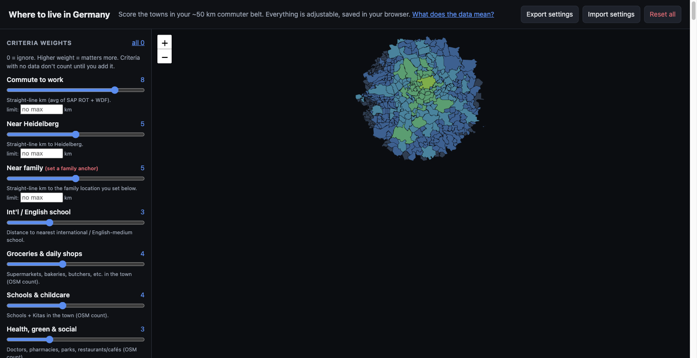

# Where to live — commuter-belt town dashboard

An interactive dashboard that scores the **towns within ~50 km of the SAP
St. Leon-Rot / Walldorf campuses** (the realistic commuter belt, ~370 municipalities
incl. Heidelberg, Mannheim, Karlsruhe, Speyer…) against the criteria that matter for a
house move, with weights you adjust live. Static site for GitHub Pages — no server,
no build step to use it, no account.



## What it does

- Ranks the towns by a weighted score across your criteria; re-ranks instantly as you drag sliders.
- Colours a map of the commuter belt by score; click any town for a full breakdown.
- Computes straight-line distances to your anchors: **SAP St. Leon-Rot**, **SAP Walldorf**,
  **Heidelberg**, and a **family** location you set yourself.
- Real per-town amenity counts from OpenStreetMap (groceries, schools/childcare, health/green/social),
  counted *inside each town's boundary* (point-in-polygon).
- Hard-filters by max distance (e.g. "work ≤ 20 km"), edits/overrides any value per town,
  and **exports/imports** your whole setup as JSON. Everything saves in your browser.

Your family/home location and all edits stay **in your browser** — never written to the repo.

## Criteria & data sources

| Criterion | Signal | Source | Confidence |
|---|---|---|---|
| Commute to work | avg straight-line km to SAP ROT + WDF | computed | real |
| Near Heidelberg / family | straight-line km | computed (family in-browser) | real |
| Int'l / English school | km to nearest of ~34 international schools | curated (`scripts/intl_schools.csv`) | real, coords city-approx |
| Groceries & daily shops | count in the town boundary | OpenStreetMap | real |
| Schools & childcare | schools + Kitas in the town | OpenStreetMap | real |
| Health, green & social | doctors/pharmacies/parks/restaurants in the town | OpenStreetMap | real |
| Political fit | 2025 Bundestag 2nd-vote share of your party | Die Bundeswahlleiterin | real, **by district (coarse)** |
| Internationality / Safety / Cost | foreign share / crime / land-price | district-level | **empty — editable** |

**Honesty notes:** amenity counts are raw OSM counts (log-scaled in the score so a big city
doesn't swamp everything, but larger towns still score higher — weight to taste). Political,
internationality, safety and cost are only available per *district*, inherited by a district's
towns; the last three ship empty — type them in per town, or wire a GENESIS token.

## Rebuild / refresh the data

Pure Python standard library — **no dependencies**. Two steps (districts feed town inheritance):

```bash
bash scripts/fetch_sources.sh          # boundaries, election CSV, OSM towns/cities/amenities
python3 -I scripts/build_data.py       # -> data/kreise.json   (district layer, for inheritance)
python3 -I scripts/build_towns.py      # -> data/towns.json + data/towns.geojson  (what the site serves)
```

`data/raw/` is git-ignored. The committed `data/towns.json` + `data/towns.geojson` make the
site work with zero setup. OSM (Overpass) is rate-limited and sometimes returns 502 when busy —
`fetch_sources.sh` retries across mirrors; just re-run if one step fails.

To change the radius or offices, edit the constants at the top of `scripts/build_towns.py`
(and the bbox/anchors in `fetch_sources.sh`).

### Filling Internationality / Safety / Cost (optional)

These are district-level and need a free [regionalstatistik.de](https://www.regionalstatistik.de)
token; `scripts/fetch_genesis.py` is a documented template. Easiest: just type values into a
town's detail panel — saved locally and exportable.

## Run locally

```bash
python3 -m http.server 8777    # then open http://localhost:8777
```

## Deploy on GitHub Pages

Push to a public repo → **Settings → Pages → Deploy from a branch → `main` / `/ (root)`**.
The site is the repo root (`index.html`).

## Tech & licenses

Vanilla HTML/CSS/JS + [Leaflet](https://leafletjs.com) (CDN). No framework, no tracking.

- Town/city boundaries & amenities © [OpenStreetMap](https://www.openstreetmap.org/copyright) contributors (ODbL), via Overpass.
- District boundaries © [BKG](https://www.bkg.bund.de) (VG250). Election © [Die Bundeswahlleiterin](https://www.bundeswahlleiterin.de) (dl-de/by-2-0).
